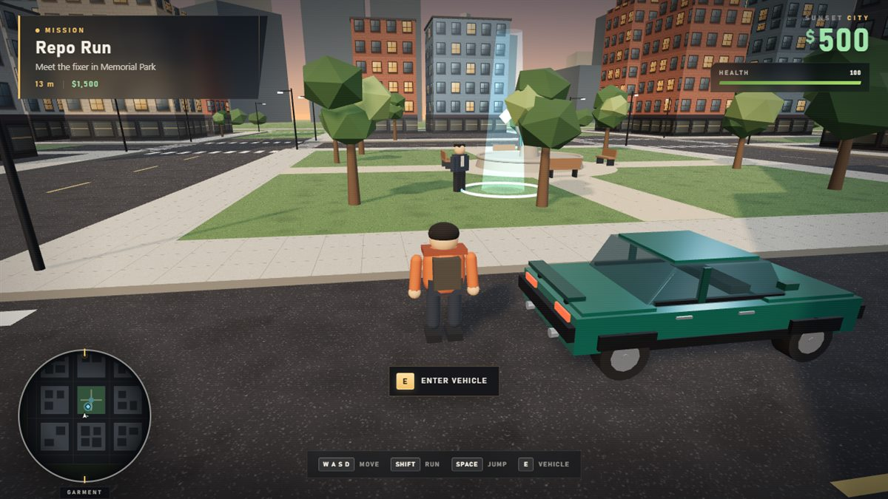
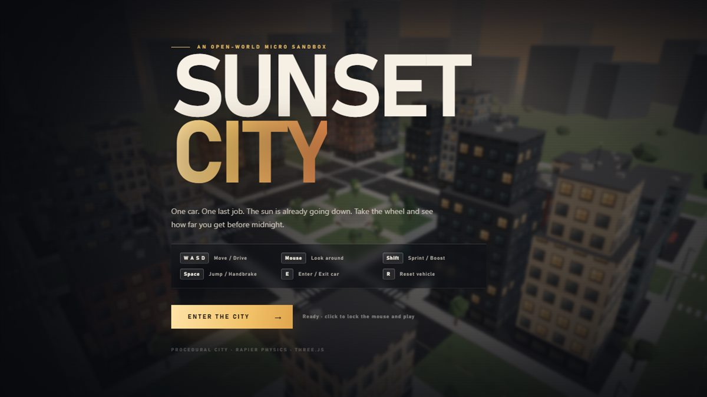
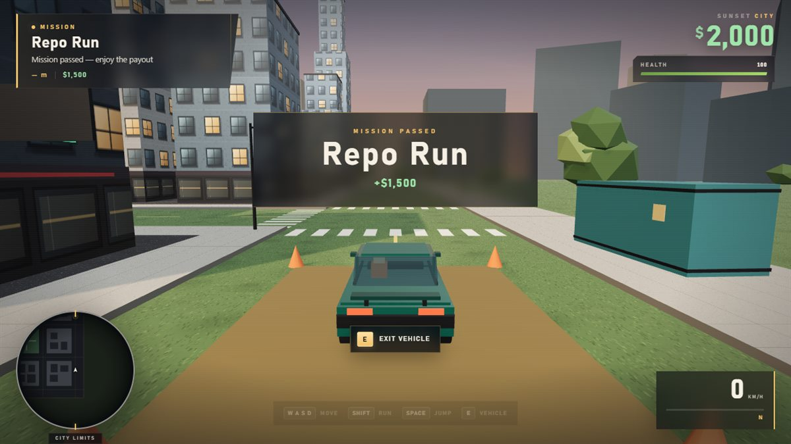
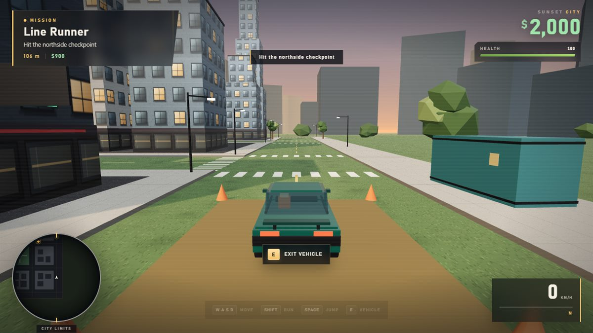

# Sunset City

A compact, GTA-inspired open-world driving prototype for the browser. The city is
procedurally built at runtime (no external art assets), rendered with **Three.js**,
simulated with **Rapier**, bundled by **Vite**, and driven by vanilla ES modules.

The current build is a stable playable vertical slice: third-person character,
collision-aware follow camera, a procedural 3 × 3-block city, a raycast-suspension
car with enter/exit, an animated HUD/radar, health/money, and a two-job mission
chain.

<p align="center">
  
</p>

<p align="center">
  
  
  
  
  
</p>

<p align="center">
  <strong>Live demo:</strong>
  <a href="https://sumuhridoy2002.github.io/sunset-city/">sumuhridoy2002.github.io/sunset-city</a>
  &nbsp;·&nbsp;
  <strong>Repository:</strong>
  <a href="https://github.com/sumuhridoy2002/sunset-city">sunset-city</a>
</p>

> The Pages URL is deployed automatically by the included GitHub Actions
> workflow once the repository is pushed and Pages is set to **GitHub Actions**.

## Quick start

Requirements: Node.js 20.19+ (developed on Node 22), a WebGL 2-capable browser, and
keyboard + mouse.

```bash
npm install
npm run dev
```

Open <http://127.0.0.1:5173/> and click **Enter the City**.

Production build:

```bash
npm run build
npm run preview
```

## Controls

| Input | On foot | In vehicle |
| --- | --- | --- |
| `W A S D` | Move | Accelerate / brake / steer |
| Mouse | Orbit camera | Orbit camera |
| `Shift` | Sprint | Engine boost |
| `Space` | Jump | Handbrake |
| `E` | Enter nearby car | Exit car (when slow enough) |
| `R` | — | Reset car to the nearest road |
| Wheel | Camera zoom | Camera zoom |
| `Esc` | Pause (releases mouse lock) | Pause |

Click the viewport to re-capture the mouse if pointer lock was lost. If pointer
lock is unavailable, drag in the world to look around.

## Features

- **Open-world city sandbox** — a deterministic 3 × 3-block city with asphalt
  roads, lane markings, crosswalks, raised sidewalks, procedural facades, retail
  bases, neon shop signs, streetlights, park greenery, a fountain and dock props.
- **Third-person character** — Rapier kinematic capsule, wall collision and
  sliding, autostep, walking, sprinting, jumping, fall damage, health regeneration,
  procedural walk/run/jump animation and a wasted/respawn flow.
- **Collision-aware follow camera** — spring-smoothed mouse orbit, zoom,
  collision boom, vehicle follow-assist, speed FOV and a cinematic title-screen
  orbit.
- **Drivable raycast car** — suspension, acceleration, braking, reverse,
  speed-sensitive steering, handbrake drift, wheel spin/suspension animation,
  headlights, brake lights and a road reset.
- **Enter / exit vehicles** — contextual prompts, clearance-tested exit positions,
  player/car hand-off and HUD/camera mode switching.
- **GTA-inspired HUD** — health, animated money, mission card, context keys,
  speedometer/gear readout, rotating minimap with objective blips, toasts,
  mission-passed banner, damage flash and WASTED overlay.
- **Data-driven missions** — two chained jobs, *Repo Run* and *Line Runner*, with
  world beacons, tracked objectives, rewards, intermissions and a free-roam state.
- **Production-focused plumbing** — procedural art only (no external assets),
  Rapier/WebGL/pointer-lock failure handling, resource disposal, fixed-timestep
  physics, instancing and a GitHub Pages deployment workflow.
- **Automated acceptance testing** — a headless Chrome/Edge suite checks movement,
  jumping, collision, vehicles, missions, HUD state and runtime errors.

## Screenshots

| Main menu | City & mission |
|:---:|:---:|
|  |  |
| *Title screen with live cinematic city backdrop* | *Third-person character, car and first mission* |
| **Mission passed** | **Line Runner** |
|  |  |
| *Mission payout and dock delivery zone* | *The second job begins with a new checkpoint* |

## Architecture

```text
index.html                  DOM shell: canvas, HUD, menu, error screen
src/
  main.js                   boot only: UI + Game construction, fatal boot handling
  config.js                 all gameplay/render tuning and palette
  core/
    Game.js                 composition root, fixed-step orchestration, pause/respawn
    Loop.js                 accumulator loop (60 Hz simulation, render once per frame)
    Physics.js              Rapier world wrapper, static bodies, ray/clearance queries
    Input.js                keyboard, pointer lock, drag look, wheel, one-shot actions
  entities/
    Player.js               kinematic capsule + procedural character rig
    Vehicle.js              raycast car + procedural model, lights, wheels
  world/
    CityLayout.js           seeded block/building data, spawns, mission locations
    City.js                 meshes, props, instancing and static colliders
    Environment.js          sky shader, sun/shadows, fog, IBL
    Materials.js            procedural CanvasTextures and shared material library
  systems/
    CameraRig.js            third-person camera and collision boom
    VehicleSystem.js        enter/exit, prompt, reset, player/car hand-off
    HUD.js                  DOM HUD facade
    Minimap.js              rotating radar renderer
    MissionSystem.js        objective state machine, rewards, chaining
    ObjectiveMarker.js      animated world beacon
  ui/
    UI.js                   title/pause menu, boot status, fatal error overlay
  styles/main.css           HUD, menu and responsive visual design
scripts/
  smoke-test.mjs            headless Chrome/Edge acceptance test + screenshots
```

Gameplay systems talk to each other through narrow interfaces. `Game.js` owns
orchestration only; the character knows nothing about the car, the car knows nothing
about the HUD, and the mission system communicates through callbacks.

## How the main systems work

- **Fixed simulation:** `GameLoop` accumulates real time and runs the simulation at
  1/60 s with at most five sub-steps. Rendering follows the browser frame rate and
  can be slow without changing physics behaviour.
- **Player:** a Rapier `KinematicCharacterController` computes slide/step movement
  from a desired translation. Horizontal velocity is damped toward a camera-relative
  target; gravity is custom; jumping and fall damage are handled by the player state
  machine. The model is a procedural rig with walk, run, idle, landing and airborne
  animation.
- **Vehicle:** a dynamic Rapier body plus `DynamicRayCastVehicleController`. Front
  wheels steer, rear wheels drive, brake forces act on all wheels, and the handbrake
  lowers rear side friction for drifts. The visual model reads live wheel suspension
  length, steering and rotation each frame.
- **City:** `CityLayout` creates a deterministic 3 × 3 block layout with eight
  building blocks and a central park. `City` builds geometry and matching colliders.
  Streetlights, road markings, trees and crosswalks are instanced; facade, pavement,
  asphalt, grass and signs are Canvas 2D textures generated at startup.
- **Camera:** mouse yaw/pitch orbit a smoothed target. A Rapier ray between the target
  and the desired camera position pulls the boom inward when a building or prop is in
  the way. The car auto-centres the camera after a short period without mouse input.
- **Missions:** each mission is data (`type`, `label`, `target`, `radius`). The system
  resolves the current target (a fixed point or the car), updates a world beacon and
  radar blip, measures distance, checks completion, pays the reward and moves to the
  next job. Adding another mission is a data-only change.

## Assets and failure handling

There are no external models, fonts or textures. All art is procedural, which keeps
loading deterministic and avoids missing-asset glitches.

- Rapier WebAssembly initialization failures are caught and shown on the fatal boot
  screen with the stack trace.
- WebGL renderer creation and context loss are handled with a readable error overlay
  and a reload action.
- Pointer-lock rejection falls back to click-drag look and shows a toast once.
- Runtime errors in the update/render loop pause the game and surface the error
  instead of silently freezing.
- Geometry/materials/textures are tracked and disposed in `dispose()` methods.

## Validation

The acceptance suite drives the real game in headless Chromium via `puppeteer-core`.
It verifies boot, HUD/radar rendering, mouse camera input, walking, jumping, wall
collision, car entry, acceleration, left steering, braking, exit placement, mission
completion, reward payout, intermission cleanup, mission chaining and HUD state. It
also fails on page/console errors and checks the render budget.

```bash
# terminal 1
npm run dev

# terminal 2
npm run smoke
```

Set `BROWSER_PATH` if Chrome/Edge is not in a standard location, and `GAME_URL` to
test a different server. Screenshots and `smoke-report.json` are written to
`screenshots/`. The page also exposes `window.__game.getDebugState()` for inspection.

Latest run: **all 45 checks passed** on both the Vite development server and the
production `vite preview` build — no page errors, console errors or failed network
requests. The deterministic suite exercised the character, camera input, collision,
vehicle, HUD and mission systems. Final preview render budget: 514 draw calls and
~18.6k triangles (including the shadow pass).

Screenshots from the test run are written to `screenshots/` (`01-menu.png`,
`02-spawn.png`, `03-mission-passed.png`, `04-second-job.png`) along with
`smoke-report.json`. The curated images used by this README live in
`docs/screenshots/`.

## Deploy to GitHub Pages

The repository includes [`.github/workflows/deploy-pages.yml`](.github/workflows/deploy-pages.yml).
Every push to `main` installs with `npm ci`, builds the production bundle and
publishes `dist/` through the official GitHub Pages actions.

1. Create a public repository named **`sunset-city`**.
2. Push this project to the `main` branch.
3. In the repository, open **Settings → Pages → Build and deployment** and set
   **Source** to **GitHub Actions**.
4. Open the **Actions** tab and wait for *Deploy to GitHub Pages* to finish.

The live game will be available at:

```text
https://sumuhridoy2002.github.io/sunset-city/
```

Vite uses a relative `base: './'`, so the same build also works from a project
subpath such as `/sunset-city/`, from `vite preview`, or from any static host.

## Performance notes

- Instanced meshes for streetlights, trees, road markings, crosswalks and skyline.
- Shared procedural materials and tiled UVs instead of per-building textures.
- 2048² sun shadow map following the player, rather than covering the whole city at
  low resolution.
- Pixel ratio capped at 1.75; shadow casting disabled on small rooftop/sign details.
- Physics has ~125 static colliders plus the player and car.
- The production JS bundle is large (~5 MB, ~1.8 MB gzip) because
  `@dimforge/rapier3d-compat` embeds its WebAssembly binary. This is expected for a
  zero-network-asset Rapier build.

## Known limitations / next steps

This is a deliberately small vertical slice, not a full GTA clone.

- One car, two missions, no pedestrians, traffic AI, police, weapons, audio or save
  persistence yet.
- The player uses a kinematic controller, so a moving car cannot physically push the
  character; entering/exiting and car collisions are handled explicitly.
- Vehicle damage/health, mission failure timers and a garage/economy are future work.
- Touch/gamepad controls are not implemented; the layout is responsive but the game
  is designed for mouse + keyboard.
- The city is bounded by grass and a distant skyline; there is no streaming world.

